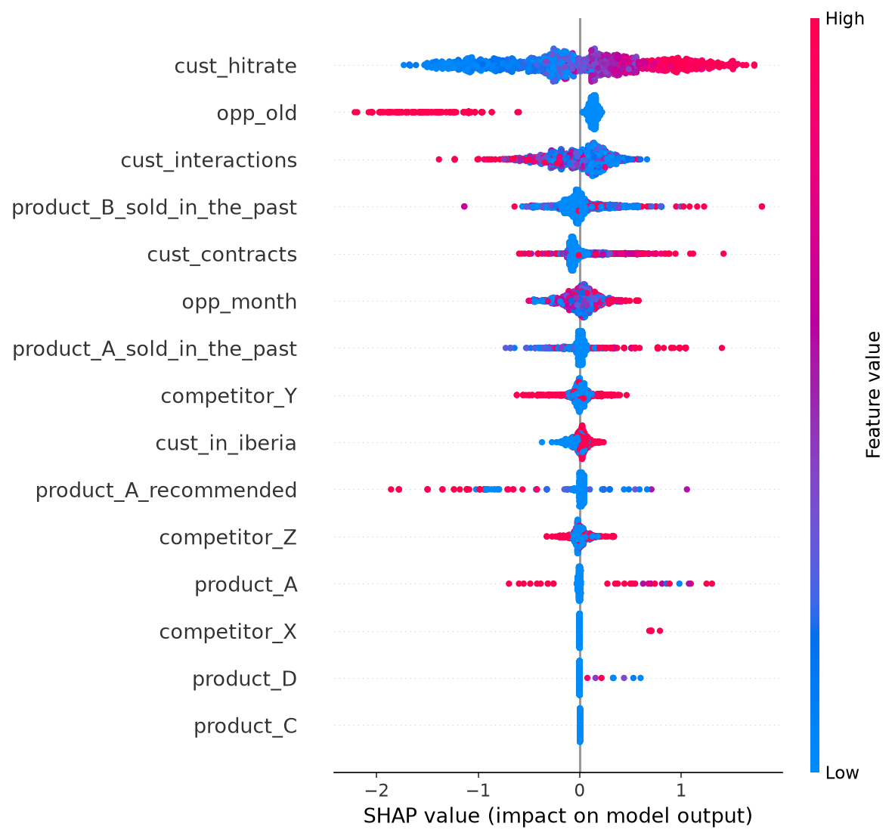

# Pràctica · Schneider Electric 2025: explicabilitat

**Repte:** predir si una oportunitat de venda es guanya (1) o es perd (0) i, sobretot, **explicar per què**.
Enunciat: `data/past/2025_schneider/enunciat.pdf` (es baixa amb `scripts/download_past_data.sh`).

| Criteri | Pes |
|---|---|
| Rendiment del model (mínim F1 0,7) | 25 % |
| Tècniques d'explicabilitat adequades | 30 % |
| Insights entenedors per a algú no tècnic | 30 % |
| Creativitat | 15 % |
| Extra: què hauríeu fet amb més temps | +5 % |

## Baseline (ja funciona)

```bash
python practica/2025_schneider_explainability/baseline.py
```

Resultat amb LightGBM:

| Validació | AUC | F1 |
|---|---|---|
| K-Fold aleatori | 0,85 | 0,76 |
| **Agrupada per duplicats (honesta)** | **0,69–0,75** | **0,68–0,70** |

> ⚠️ **Lliçó clau: el 77 % de les files tenen exactament les mateixes features que una altra.** Amb un K-Fold aleatori, les còpies cauen a train i a validació i el model les memoritza. Com més gran és el model, més infla la CV: un LightGBM de 1.500 arbres arriba a 0,91 amb K-Fold i es queda en 0,70 agrupat. `validation.duplicate_report(X)` ho detecta i `validation.group_kfold` + `duplicate_groups(X)` ho corregeix. **Al dia D, pregunteu als mentors com han fet el split de test.** Si és aleatori, els duplicats també hi seran, i això s'ha de dir a la presentació.

Genera a `outputs/` el beeswarm de SHAP, dos waterfalls (oportunitat guanyada i perduda) i la importància de les variables.



**Primera lectura:** `cust_hitrate` (l'historial d'èxit amb el client) és de lluny el factor més important. Les oportunitats que fa temps que estan obertes (`opp_old` alt) es perden molt més.

## Tasques de la setmana 1

Cada persona n'agafa una i la presenta en 2 minuts:

- [ ] **Superar el 0,7 de F1 amb validació agrupada**: features noves, CatBoost, regularitzar més…
- [ ] **PDP o ALE** de les 3 variables principals. Hi ha llindars (p. ex. a partir de quin hitrate es guanya)?
- [ ] **Interaccions**: `shap.plots.scatter(sv[:, "cust_hitrate"], color=sv[:, "opp_old"])`. Una oportunitat antiga amb un bon client es guanya?
- [ ] **Competidors**: quin competidor fa més mal? Comparar els valors SHAP de `competitor_X/Y/Z`.
- [ ] **Contrafactual**: per a una oportunitat perduda, quin és el canvi mínim que la faria guanyar?
- [ ] **LLM**: passar `explain.top_reasons()` a un LLM perquè ho redacti per a un comercial.
- [ ] **Demo**: adaptar `app/streamlit_demo.py` perquè es pugui introduir una oportunitat i veure'n el perquè.
