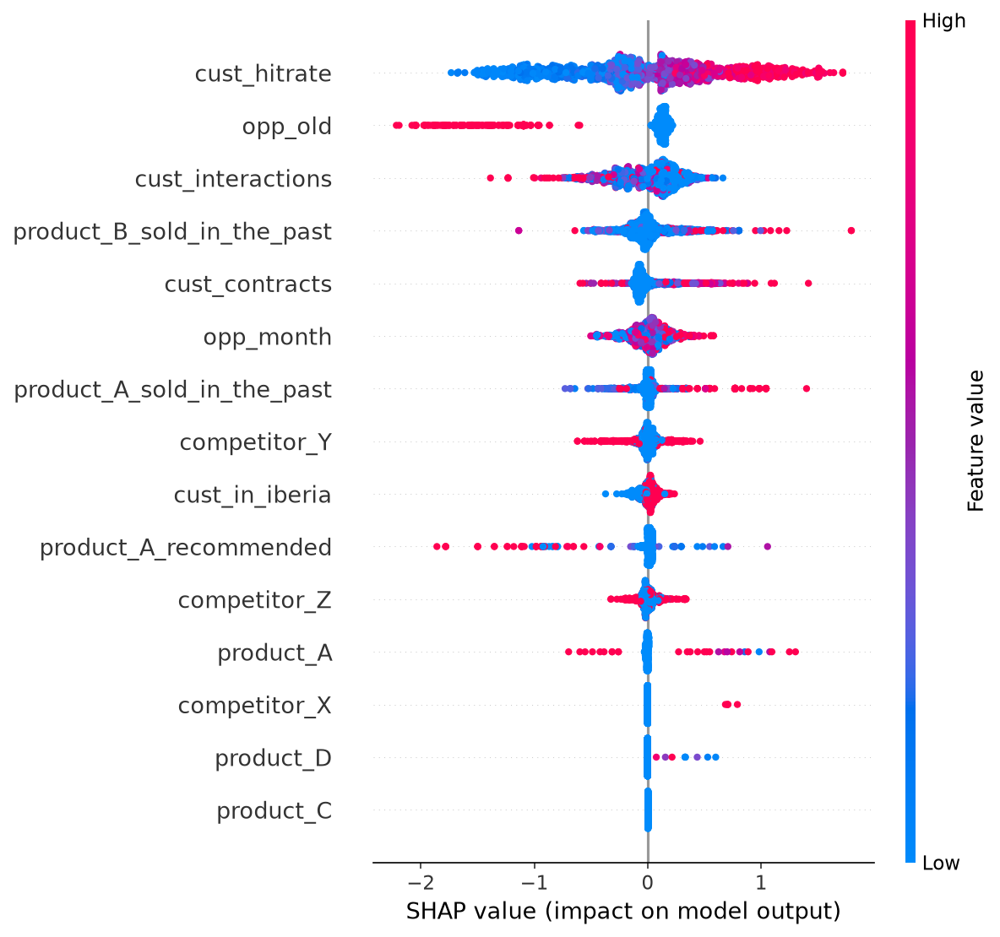

# Schneider Electric 2025 · Per què guanyem (o perdem) una venda?

> **2025** · Schneider Electric · Classificació binària + **explicabilitat** · Rúbrica (F1 ≥ 0,7 i insights) · ✅ Dades públiques

## Context

Schneider Electric (gestió de l'energia i automatització, més de 130.000 treballadors) ven solucions i projectes complexos. El seu CRM té milions de registres d'**oportunitats de venda** passades. L'equip *Strategic Advanced Data Analytics* d'Ibèria vol saber **quins patrons fan que una oportunitat es guanyi o es perdi**, per decidir on posar l'esforç comercial.

## La tasca

1. **Entrenar un classificador binari**: l'oportunitat es guanya (1) o es perd (0). Mínim **F1 = 0,7**.
2. **Explicar-lo**, que és el repte de veritat:
   - **Global**: quines variables importen més en general?
   - **Local**: per què el model diu que *aquesta* oportunitat concreta es guanya o es perd?
3. Lliurar un informe o presentació amb el rendiment, la proposta de tècnica d'explicabilitat (i com la faria servir un usuari) i els insights.

**Repartiment del temps que recomanaven:** 15 % entrenar i **85 % explicar**.
**Idea seva:** fer servir un **LLM** per convertir els gràfics de SHAP en text llegible.

## Dades

`dataset.csv`: 35.899 oportunitats, un 47 % guanyades. Ja ve **net i escalat**, a punt per entrenar.

| Columna | Descripció |
|---|---|
| `id` | Identificador. **No és predictiu: no fer-lo servir** |
| `product_A_sold_in_the_past` | Vendes històriques del producte A a aquest client |
| `product_B_sold_in_the_past` | Vendes històriques del producte B a aquest client |
| `product_A_recommended` | Si se li havia recomanat el producte A |
| `product_A`, `product_C`, `product_D` | Quantitat de cada producte que s'intenta vendre en aquesta oportunitat |
| `cust_hitrate` | Taxa d'èxit amb el client en interaccions anteriors |
| `cust_interactions` | Nombre d'interaccions amb el client |
| `cust_contracts` | Contractes signats amb el client |
| `opp_month` | Mes de creació de l'oportunitat |
| `opp_old` | Si l'oportunitat fa molt de temps que és oberta |
| `competitor_X`, `competitor_Y`, `competitor_Z` | Presència de cada competidor |
| `cust_in_iberia` | Client a Ibèria |
| `target_variable` | **1 = guanyada, 0 = perduda** |

## Avaluació

| Criteri | Pes |
|---|---|
| Rendiment del model | 25 % |
| Ús de tècniques d'explicabilitat adequades | 30 % |
| Insights entenedors per a algú **no tècnic** | 30 % |
| Creativitat | 15 % |
| **Extra**: què hauríeu fet amb més temps | +5 % |

Tècniques que suggerien: SHAP, LIME, PDP, ALE i importància de variables. Referència: [*Interpretable ML*, de Molnar](https://christophm.github.io/interpretable-ml-book/).

## Format d'entrega

Informe o presentació curta (no hi havia Kaggle) i el repo amb el codi.

## Estratègia guanyadora

**⚠️ Trampa del dataset (la vam descobrir en preparar-lo):** **el 77 % de les files tenen exactament les mateixes features que una altra.** Amb un K-Fold aleatori les còpies cauen a train i a validació i el model les memoritza:

| Model | K-Fold aleatori | Agrupat per duplicats |
|---|---|---|
| LightGBM 400 arbres | AUC 0,85 · F1 0,76 | AUC **0,71** · F1 **0,68** |
| LightGBM 1.500 arbres | AUC 0,91 · F1 0,83 | AUC **0,70** · F1 **0,67** |

És a dir, el **F1 ≥ 0,7 "fàcil" era en part un miratge**. Explicar-ho a la presentació ("hem detectat duplicats i aquesta és l'estimació honesta") és exactament el tipus d'insight que puntua a *creativitat* i *rigor*.

**Pla:**
1. Model "prou bo" en 1 hora: LightGBM i llindar òptim de F1 sobre OOF (`metrics.best_f1_threshold`).
2. **Global**: SHAP beeswarm i PDP o ALE de les 3–5 variables principals, amb una frase de negoci per a cada gràfic.
3. **Local**: waterfall d'una oportunitat guanyada, d'una de perduda i d'una "frontera" (≈ 0,5).
4. **Accionable**: contrafactuals ("si el client tingués X, la probabilitat pujaria a Y").
5. **Producte**: app de Streamlit on el comercial introdueix una oportunitat i veu la probabilitat i el perquè ([`app/streamlit_demo.py`](../../app/streamlit_demo.py)).
6. **LLM**: `explain.top_reasons()` → prompt → paràgraf per al comercial.

**Primers insights del baseline:**
- `cust_hitrate` és de lluny el factor més important: un bon historial amb el client fa pujar molt la probabilitat de guanyar.
- Les oportunitats antigues (`opp_old`) es perden molt més.
- `cust_interactions` i les vendes passades de B també pesen.

## Com practicar-lo

```bash
bash scripts/download_past_data.sh schneider
python reptes/2025_schneider_explicabilitat/baseline.py   # → outputs/ amb els gràfics SHAP
streamlit run app/streamlit_demo.py
```



**Tasques:**
- [ ] Superar F1 0,7 **amb validació agrupada** (features, CatBoost, regularització).
- [ ] PDP o ALE de `cust_hitrate`, `opp_old` i `cust_interactions`: hi ha llindars?
- [ ] Interaccions: `shap.plots.scatter(sv[:, "cust_hitrate"], color=sv[:, "opp_old"])`.
- [ ] Quin competidor fa més mal?
- [ ] Contrafactual d'una oportunitat perduda.
- [ ] Informe automàtic amb un LLM a partir dels valors SHAP.

## Fonts
- [data-students/datathon2025-challenges/Schneider Electric](https://github.com/data-students/datathon2025-challenges/tree/main/Schneider%20Electric) (`statament.pdf`, `dataset.csv`)
- Exemple d'equip: [davoriols/DatathonFME2025_Schneider](https://github.com/davoriols/DatathonFME2025_Schneider) (arbre de decisió)
